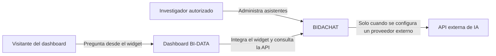
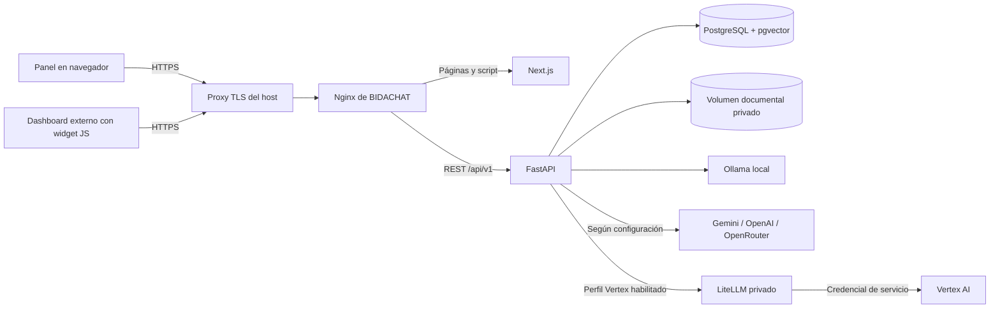
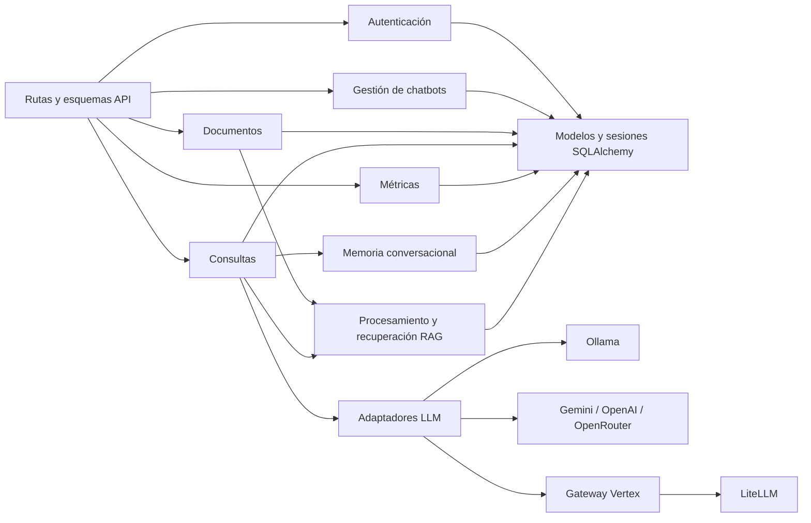

# Arquitectura de BIDACHAT

Esta explicación representa la implementación del repositorio. El [SRS](../SRS.md) define el comportamiento requerido; el [Compose de producción](../docker-compose.production.yml) y las [rutas FastAPI](../backend/app/api/router.py) describen la configuración ejecutable. Conforme a la [decisión documental](documentation-decision.md#convención-para-diagramas), los gráficos usan niveles del [modelo C4](https://c4model.com/) y sintaxis Mermaid. En C4, “contenedor” significa aplicación o almacén en ejecución y no exige un contenedor Docker.

## Contexto del sistema

BIDACHAT administra chatbots y fuentes, procesa consultas y registra métricas. El dashboard BI-DATA aloja el widget, pero la base de datos, el backend y los archivos originales permanecen en infraestructura controlada por el proyecto. No hay servicios externos para base de datos o backend; las API de IA configuradas son la integración externa de ejecución permitida por RNF-15.

## Aplicaciones y almacenes en ejecución

El panel y el widget son clientes de la API REST. Nginx ofrece panel, script y API bajo un origen; en producción solo publica un puerto en `127.0.0.1` para el proxy TLS del host. FastAPI concentra autenticación, gestión, procesamiento documental, recuperación, proveedores y métricas. Next.js y el widget no consultan PostgreSQL ni proveedores de IA directamente. LiteLLM solo se inicia con el perfil opcional `vertex`, no publica un puerto al host y es el único proceso que monta la credencial de servicio de Google.

## Componentes lógicos de FastAPI

Las rutas permanecen delgadas y delegan reglas a `app/services/`. La recuperación
RAG usa documentos asociados al chatbot; la memoria conserva solamente mensajes
textuales recientes de una conversación válida. Los adaptadores de `app/llm/`
encapsulan cada proveedor y evitan que las credenciales lleguen a los clientes.

La lógica del backend vive en `app/services/`; `app/api/` expone rutas, `app/models/` representa persistencia, `app/schemas/` valida el contrato y `app/llm/` aísla proveedores. Es una arquitectura cliente-servidor con servicios lógicos dentro de un backend FastAPI. El despliegue no separa esos servicios como microservicios.

El widget envía cada consulta mediante HTTP a la API; no existe conexión WebSocket permanente. El backend recupera fragmentos asociados al chatbot, combina la pregunta con el contexto permitido y registra el resultado y el tiempo. Para datos y límites específicos, consultar [diseño de base de datos](database-design.md), [memoria y contexto](conversation-memory.md), [Vertex mediante LiteLLM](vertex-ai.md), [rutas](api-routes.md) y [guía del proxy](deployment/reverse-proxy.md).
