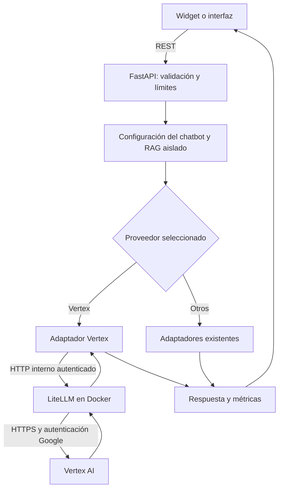

## Context

Motivación y alcance: [proposal.md](proposal.md). Inspección del repositorio: 2026-10-15.

`backend/app/llm/provider.py` concentra actualmente Gemini, Ollama, OpenAI y OpenRouter. OpenAI usa Responses; OpenRouter usa Chat Completions. `conversation_service.py` captura el modelo ejecutado antes de la llamada; `document_processing_service.py` usa un proveedor visual global independiente. Los embeddings admiten Gemini/Ollama y los vectores locales tienen 768 dimensiones.

El catálogo se inserta desde `bootstrap.py`; actualmente el listado lee las filas almacenadas. El editor ya separa proveedor y modelo. Compose de producción pasa variables explícitas y Actions transfiere una lista limitada de archivos: añadir solo variables al `.env` no bastaría.

## Goals / Non-Goals

**Goals:** un camino Vertex identificable y comprobable, con configuración validada, errores seguros y responsabilidades pequeñas. Mantener el contrato REST y el procesamiento RAG.

**Non-Goals:** migrar todos los proveedores al gateway, implementar WebSocket, descubrimiento automático de todo Google, balanceo, fallback entre modelos, una segunda base de datos o reescribir la capa LLM completa.

## Decisions

### 1. Flujo y responsabilidades

El contenedor es un intermediario de inferencia justificado por esta integración. FastAPI conserva las reglas de negocio. La inferencia Vertex ocurre en Google; el gateway se ejecuta localmente.

| Área                                              | Cambio propuesto             | Responsabilidad                                                             |
| ------------------------------------------------- | ---------------------------- | --------------------------------------------------------------------------- |
| `backend/app/llm/vertex_gateway.py`               | Módulo nuevo                 | Crear mensajes texto/imagen, llamar al gateway y validar respuesta          |
| `backend/app/llm/provider.py`                     | Rama de delegación pequeña   | Seleccionar adaptador y conservar construcción común de contexto/guardrails |
| `backend/app/core/config.py`                      | Campos validados             | Habilitación, URL interna, secreto y modelos permitidos                     |
| `backend/app/bootstrap.py` y servicio de chatbots | Registro/disponibilidad      | Modelos explícitos; conservar referencias históricas                        |
| Servicios de conversación/documentos              | Integración mínima           | Reutilizar registro de consultas, RAG y perfil visual                       |
| Frontend                                          | Etiquetas/tipos/estados      | Mostrar Vertex y modelos utilizables en selectores actuales                 |
| `docker/litellm/config.yaml`                      | Configuración estática nueva | Correspondencia de modelos, autenticación y límites                         |
| Compose, despliegue y Actions                     | Perfil opcional              | Arranque, recursos, secretos y distribución de archivos                     |

Usar HTTPX ya instalado y el contrato Chat Completions del gateway. No añadir el SDK de LiteLLM a Python. Evitar adaptar OpenAI Responses a la fuerza: su integración actual tiene un contrato distinto. Helpers compartidos solo cuando exista duplicación concreta; sin jerarquías de clases ni registros dinámicos innecesarios.

Funciones cortas con nombres ingleses, datos tipados y errores explícitos. Las rutas no construyen prompts, no eligen modelos alternativos ni conocen credenciales Google. Cada prueba debe comprobar comportamiento observable.

### 2. Catálogo y persistencia

Empezar con un modelo multimodal cuyo acceso esté comprobado en el proyecto Google. Usar `provider=vertex` y un identificador explícito; el nombre público del gateway corresponde a un único modelo Vertex. No usar un alias genérico que pueda cambiar silenciosamente de destino.

Reutilizar `llm_models` y las referencias existentes: un modelo puede pertenecer a muchos chatbots y consultas. No modificar ni eliminar filas referenciadas al retirar una entrada de configuración. Un modelo retirado deja de estar disponible para nuevas selecciones; un chatbot que aún lo use recibe un estado/error explícito hasta ser reconfigurado. No sustituirlo automáticamente.

Validar el modelo devuelto por LiteLLM contra el identificador o equivalencia documentada del modelo solicitado. Prohibir fallback en esta fase para preservar la identidad histórica. Si Google ofrece únicamente un identificador flotante, registrar esa limitación; no afirmar trazabilidad a una revisión física que el proveedor no expone.

Conservar las transacciones existentes: registrar inicio y modelo antes de inferencia, finalizar éxito/fallo después, publicar chunks de una fuente solo cuando su procesamiento esté completo. No cambiar aislamiento, asociaciones ni borrado documental. No se prevé migración; cualquier necesidad descubierta debe justificarse frente a [database-design.md](../../../docs/database-design.md) antes de introducirla.

### 3. Configuración y credenciales

Nombres propuestos; aún no implementados:

| Variable/archivo                       | Dónde               | Uso                                                                            |
| -------------------------------------- | ------------------- | ------------------------------------------------------------------------------ |
| `VERTEX_ENABLED`                       | Backend/despliegue  | Activa integración de forma explícita                                          |
| `LITELLM_BASE_URL`                     | Backend             | Origen interno, por ejemplo `http://litellm:4000`                              |
| `LITELLM_MASTER_KEY`                   | Backend y gateway   | Secreto compartido; nunca se devuelve por API                                  |
| `VERTEX_PROJECT`                       | Gateway             | ID del proyecto Google Cloud                                                   |
| `VERTEX_LOCATION`                      | Gateway             | Ubicación compatible con el modelo y política de datos                         |
| `VERTEX_MODEL`                         | Backend/gateway     | Modelo inicial explícito; ampliar mediante lista validada cuando sea necesario |
| `GOOGLE_APPLICATION_CREDENTIALS`       | Gateway             | Ruta dentro del contenedor a las credenciales montadas                         |
| `LITELLM_CPUS`, `LITELLM_MEMORY_LIMIT` | Compose/despliegue  | Recursos obligatorios al habilitar el perfil                                   |
| `VISION_PROVIDER`, `VISION_MODEL`      | Backend, existentes | Perfil visual documental opcional; preservar OpenAI por defecto actual         |

En desarrollo se puede utilizar ADC. En VPS externo: preferir federación de identidad cuando exista un emisor confiable para ese VPS; en su ausencia usar cuenta de servicio dedicada y archivo JSON montado solo en LiteLLM, de solo lectura, fuera del repositorio y de las imágenes. La identidad OIDC de un job de GitHub no autentica por sí sola un proceso permanente del VPS.

Permisos mínimos de inferencia; partir de `roles/aiplatform.user` y comprobar si se puede acotar para el caso. No Owner/Editor. Habilitar facturación y API `aiplatform.googleapis.com`. Una clave Gemini de AI Studio no sustituye esta autenticación Vertex.

Validar configuración habilitada antes de arrancar. Con integración deshabilitada, desarrollo/producción deben arrancar sin credenciales Google ni recursos LiteLLM. Distinguir en UI “configurado” de “verificado”: tener un secreto no demuestra disponibilidad del proveedor.

### 4. Docker y operación

LiteLLM sin base de datos, panel administrativo, virtual keys, cache ni callbacks externos. Configuración estática y clave del gateway. Imagen oficial fijada por versión y digest comprobados; revisar opciones efectivas de esa versión, incluida desactivación de telemetría y logs de contenido.

Perfil Compose `vertex` opcional en desarrollo y producción, sin `ports` públicos, configuración y credenciales montadas en lectura. El backend solo depende de la disponibilidad del gateway cuando se habilita. Validar especialmente interpolación de Compose: un perfil inactivo no debe exigir variables de su servicio por accidente. El preflight del despliegue comprueba coherencia entre perfil, variables y archivos.

El VPS observado dispone de aproximadamente 7,8 GiB compartidos. Antes de fijar límites medir consumo real del gateway y recalcular el presupuesto conjunto; no sumar un contenedor a los límites anteriores sin comprobar margen. Healthcheck interno sin llamada facturable a inferencia. Pruebas de disponibilidad real separadas y acotadas.

No añadir un nuevo camino público en Nginx. Actualizar el paquete transferido por Actions para incluir configuración y archivos necesarios, nunca credenciales. Conservar la regla vigente de despliegue mediante PR aprobado e integrado.

### 5. Errores, seguridad y coste

Conservar validación de adjuntos, límites de uso, filtrado y delimitación de contexto no confiable, y consultas aisladas por chatbot. Estos controles reducen riesgos de prompt injection; no garantizan que un modelo nunca obedezca contenido malicioso.

Acotar timeout total del adaptador y salida; evitar multiplicación de reintentos entre backend y gateway. Inicialmente sin reintentos ni fallback automáticos facturables. Mapear autenticación, permiso, cuota, timeout, indisponibilidad, respuesta inválida y bloqueo de seguridad a errores seguros. No marcar respuestas vacías/bloqueadas como consultas exitosas. Registrar duración y modelo de la ejecución con los mecanismos existentes; logs sin prompt completo, imagen ni secretos.

LiteLLM sin base de datos no proporciona enforcement de su presupuesto global `max_budget`. Las alertas presupuestarias de Google tampoco son un corte automático del gasto. Para aceptación acordar presupuesto y máximo de llamadas, limitar tokens, verificar precios del modelo seleccionado y registrar consumo real. No reutilizar sin comprobación el presupuesto histórico de otro conjunto de pruebas.

### 6. Verificación y evidencia

| Nivel            | Casos                                                                                      | Evidencia de aceptación                                                                     |
| ---------------- | ------------------------------------------------------------------------------------------ | ------------------------------------------------------------------------------------------- |
| Contrato aislado | Texto, PNG/JPEG/WebP, cabeceras, modelo, errores 401/403/429/503, timeout, vacío/bloqueo   | Pruebas sin cargos y sin secretos                                                           |
| Integración      | Catálogo, cambio de modelo, retiro de disponibilidad, consulta y métricas, RAG de dos bots | PostgreSQL/pgvector real para datos; transporte controlado                                  |
| Gateway          | Config válida/inválida, autenticación interna, perfil apagado/encendido, reinicio          | Compose y gateway reales; llamadas de inferencia separadas                                  |
| Vertex real      | Pregunta de dato conocido, imagen con dato conocido, RAG textual/visual y contexto web     | Modelo, resultado esperado/obtenido, tiempo y consumo; sin considerar mocks aceptación real |
| Regresión        | Proveedores existentes, login, editor, página externa y métricas                           | Flujos afectados conservados                                                                |

Medir respuestas con muestras comparables, separando primera solicitud y solicitudes posteriores. Informar tamaño de muestra, mediana y p95 cuando la muestra permita interpretarlo; no prometer mejoras ni inventar umbrales. Comprobar falsos positivos y limitaciones de los guardrails con un corpus pequeño documentado.

## Risks / Trade-offs

- Credenciales/permiso/región incorrectos → preflight local y llamada real mínima con errores diferenciados.
- Memoria insuficiente en VPS → medir y presupuestar antes de habilitar producción.
- Un salto HTTP adicional → medir tiempo extremo a extremo; no atribuir automáticamente menor latencia al gateway.
- Alias/modelos retirados → correspondencia explícita, sin cambios de historial ni fallback silencioso.
- Dependencia de imagen externa → fijar versión/digest, revisar vulnerabilidades y ensayar actualización.
- Contenido enviado a Google → limitar contexto al necesario y documentar región, permisos y tratamiento aplicable.
- Salida a servicios de autenticación Google → documentar como parte necesaria de la integración IA bajo RNF-15, sin habilitar almacenamiento/backend externos.

## Migration Plan

1. Aprobar alcance e incorporar la ampliación al SRS; completar valores no secretos y presupuesto.
2. Implementar y verificar en desarrollo con Vertex apagado y encendido.
3. Ejecutar aceptación real acotada y guardar resultados sanitizados.
4. Preparar credenciales y recursos del VPS, construir imágenes y distribuir configuración mediante flujo aprobado.
5. Activar un chatbot de prueba, validar texto/imagen/contexto/métricas desde página externa.
6. Habilitar otros chatbots por selección explícita. El perfil documental visual cambia solo si se decide y configura.
7. Reversión: reasignar chatbots de prueba a un modelo anterior disponible, restaurar perfil visual anterior si se cambió y desactivar Vertex. Conservar filas e historial; revisar fuentes en proceso y reintentar fallidas explícitamente, sin borrarlas.

## Open Questions

Valores requeridos antes de pruebas reales: proyecto Google, ubicación, ID de modelo habilitado, identidad disponible en VPS y presupuesto de pruebas. Recursos del gateway se fijan con mediciones. Son parámetros de esta arquitectura, no autorización para cambiarla.

## References

Consultadas el 2026-10-15:

- [LiteLLM: Vertex AI](https://docs.litellm.ai/docs/providers/vertex).
- [LiteLLM: Docker y operación sin base de datos](https://docs.litellm.ai/docs/proxy/docker_quick_start).
- [LiteLLM: configuración](https://docs.litellm.ai/docs/proxy/configs).
- [Google: inicio y habilitación](https://cloud.google.com/vertex-ai/generative-ai/docs/start/quickstarts/quickstart-multimodal).
- [Google: federación de identidad](https://docs.cloud.google.com/iam/docs/workload-identity-federation).
